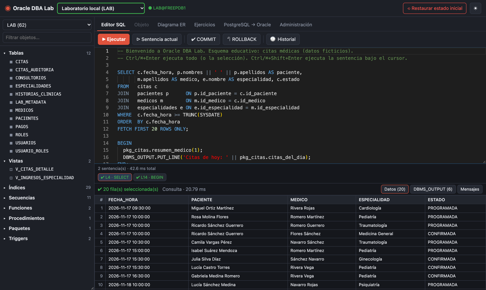
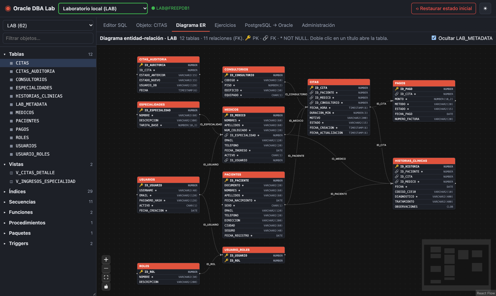
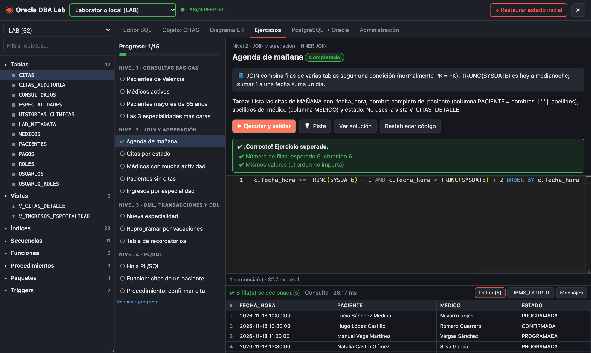
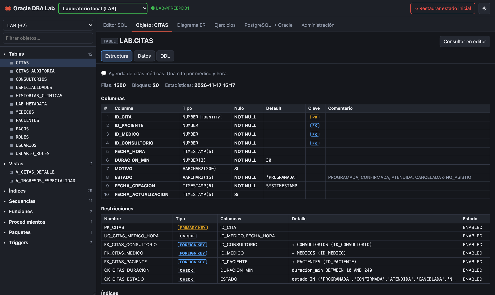
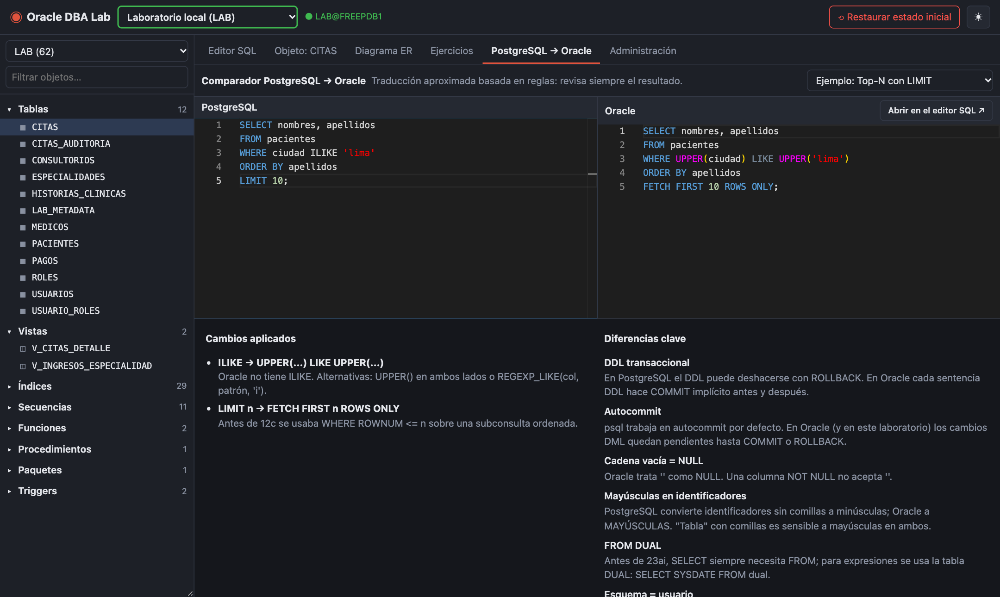
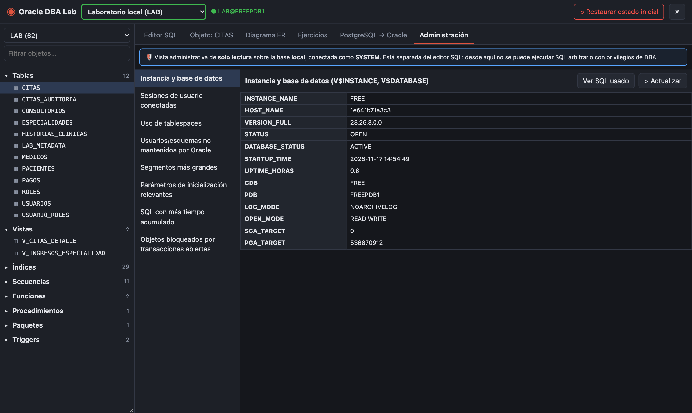
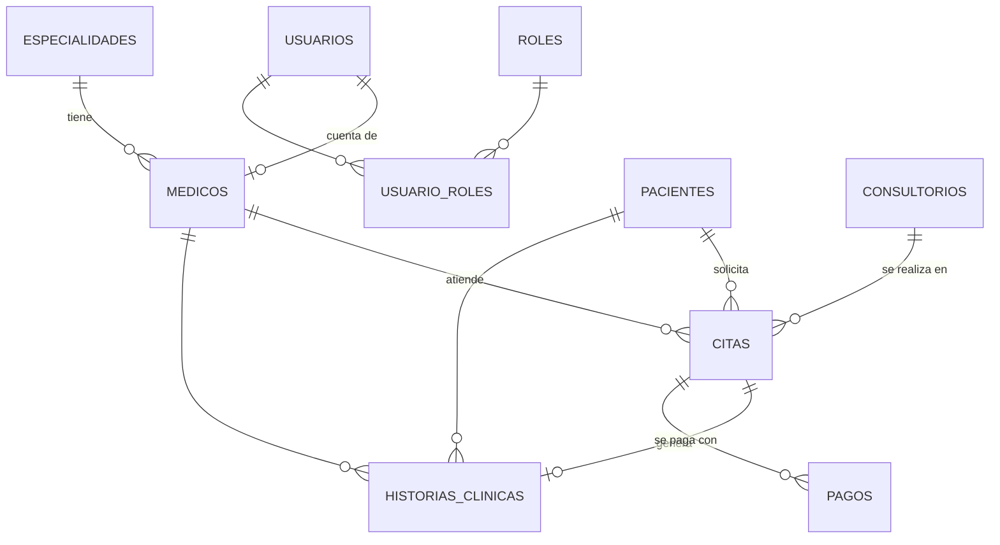
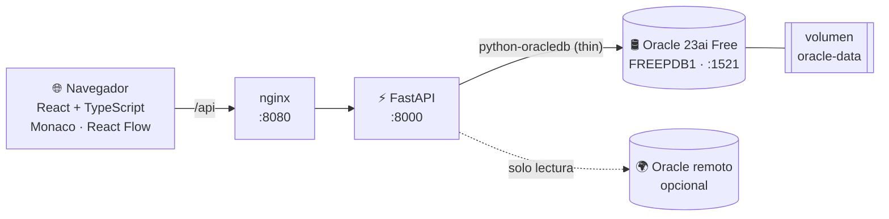

<div align="center">

# 🛢️ Oracle DBA Lab

**Tu laboratorio personal para aprender y practicar Oracle Database: SQL, PL/SQL y administración.**
Corre en tu propia máquina, con un Oracle real, en Ubuntu, Mac Intel y Mac Apple Silicon.

[](https://www.oracle.com/database/free/)
[](https://fastapi.tiangolo.com/)
[](https://python-oracledb.readthedocs.io/)
[](https://react.dev/)
[](https://www.typescriptlang.org/)
[](https://docs.docker.com/compose/)
<br>

-informational)


[Inicio rápido](#-inicio-rápido) ·
[Funcionalidades](#-funcionalidades) ·
[Capturas](#-capturas) ·
[Arquitectura](#-arquitectura) ·
[Seguridad](#-seguridad) ·
[Documentación](#-documentación)



</div>

---

## ✨ ¿Por qué?

Aprender Oracle suele exigir instalar una base pesada, un cliente aparte y conseguir datos con los que practicar.
**Oracle DBA Lab** lo junta todo en un solo `docker compose up`:

- 🧠 **Un Oracle de verdad** (Database 23ai Free), no un simulador. Lo que aprendes funciona igual en producción.
- 🏥 **Datos listos para practicar**: un esquema de **citas médicas** con 1 500 citas, 300 pacientes, pagos,
  historias clínicas, vistas, paquetes y triggers. Todo ficticio y restaurable con un clic.
- 🎯 **Ejercicios con corrección automática**, de `SELECT` básico a procedimientos PL/SQL con excepciones.
- 🍎🐧 **Nativo en tu CPU**: imagen multi-arquitectura (amd64 y arm64). En Apple Silicon no hay emulación.

## 🚀 Inicio rápido

> Requisitos: Docker con Compose v2 y al menos 4 GB de RAM asignados a contenedores.

```bash
git clone https://github.com/rapanuti/ORACLE-DBA-LAB.git
cd ORACLE-DBA-LAB
cp .env.example .env
./scripts/check-env.sh          # comprueba SO, arquitectura, Docker y la imagen ANTES de descargar
docker compose up -d --build    # la primera vez descarga ~1,5 GB
```

Abre **http://localhost:8080** 🎉. El esquema educativo se crea solo unos segundos después de que Oracle arranque.

| Plataforma | Motor Docker | Imagen de Oracle |
|---|---|---|
| 🐧 Ubuntu x86-64 | Docker Engine | `amd64` nativa |
| 🍎 Mac Intel | Docker Desktop o Colima | `amd64` nativa |
| 🍏 Mac Apple Silicon (M1–M4) | Docker Desktop o Colima | `arm64` nativa |
| 🌐 Sin Oracle local | `docker-compose.remote.yml` | Tu instancia Oracle remota |

Las instrucciones paso a paso para cada sistema están en **[docs/instalacion.md](docs/instalacion.md)**.

## 🧰 Funcionalidades

<table>
<tr>
<td width="50%" valign="top">

### ⌨️ Editor SQL
- Monaco (el editor de VS Code) con **autocompletado** de tablas, columnas, alias y funciones
- Ejecuta el script completo, la **selección** o la **sentencia bajo el cursor**
- `SELECT`, DML, DDL, `COMMIT`/`ROLLBACK` y **bloques PL/SQL** terminados en `/`
- Filas, **tiempo por sentencia**, **errores ORA/PLS con número de línea** y **DBMS_OUTPUT**
- Errores de compilación de `USER_ERRORS` marcados en el editor
- **Transacciones reales**: una sesión Oracle por pestaña e indicador de cambios pendientes
- Historial de ejecuciones

</td>
<td width="50%" valign="top">

### 🗂️ Explorador y diagrama
- Esquemas, tablas, vistas, índices, secuencias, funciones, procedimientos, paquetes y triggers
- Estructura: tipos, IDENTITY, PK/FK/UNIQUE/CHECK, índices, triggers y comentarios
- Datos paginados y ordenables
- DDL generado con `DBMS_METADATA`
- **Diagrama entidad-relación** automático a partir de las claves foráneas

</td>
</tr>
<tr>
<td valign="top">

### 🎓 Ejercicios progresivos
15 ejercicios en 4 niveles:
1. Consultas básicas
2. JOIN y agregación
3. DML, transacciones y DDL
4. PL/SQL: bloques, funciones, procedimientos y excepciones

Cada uno trae explicación, pista, solución y **validación automática** contra la base.

</td>
<td valign="top">

### 🔁 PostgreSQL → Oracle
Traductor didáctico por reglas: `LIMIT` → `FETCH FIRST`, `SERIAL` → `IDENTITY`, `::` → `CAST`,
`ILIKE`, `NOW()`, `STRING_AGG` → `LISTAGG`, `DATE_TRUNC`, `generate_series`…
Explica **cada diferencia** y avisa de lo que requiere revisión manual
(`ON CONFLICT`, `RETURNING`, `'' = NULL`…).

### 🛡️ Administración
Instancia, sesiones, tablespaces, usuarios, segmentos, parámetros, top SQL y bloqueos.
Es de solo lectura y **muestra el SQL** que usa contra las vistas `V$` y `DBA_`.

</td>
</tr>
</table>

## 📸 Capturas

<table>
<tr>
<td><p align="center"><b>Diagrama ER automático</b></p></td>
<td><p align="center"><b>Ejercicios con validación</b></p></td>
</tr>
<tr>
<td><p align="center"><b>Explorador de objetos</b></p></td>
<td><p align="center"><b>Comparador PostgreSQL → Oracle</b></p></td>
</tr>
<tr>
<td colspan="2" align="center"><p align="center"><b>Administración (V$ / DBA_)</b></p></td>
</tr>
</table>

## 🏥 Esquema educativo: citas médicas



Además de las tablas incluye las vistas `V_CITAS_DETALLE` y `V_INGRESOS_ESPECIALIDAD`, la secuencia `SEQ_FACTURA`,
las funciones `FN_EDAD` y `FN_TOTAL_PAGADO_PACIENTE`, el procedimiento `PR_REGISTRAR_PAGO`, el paquete `PKG_CITAS`
y triggers de auditoría. Las fechas son **relativas al día de creación**, así que siempre hay citas "de hoy".

## 🏗️ Arquitectura



| Perfil | Usuario | Uso | Permisos |
|---|---|---|---|
| `lab` | `LAB` | Editor, explorador, ejercicios | Lectura y escritura sobre su esquema |
| `external` | Configurable | Consultar una base real | **Solo lectura** (por defecto) |
| `admin` | `SYSTEM` | Vistas de administración | Solo lectura; **no disponible en el editor** |

## 🔐 Seguridad

| Riesgo | Protección |
|---|---|
| `DROP`, `TRUNCATE`, `DELETE`/`UPDATE` **sin WHERE**, `ALTER … DROP` | No se ejecuta nada hasta que confirmas en un diálogo que lista cada sentencia |
| Modificar una base externa por accidente | Bloqueo previo de todo lo que no sea `SELECT`/`WITH`, y además `SET TRANSACTION READ ONLY` |
| Borrar un esquema que no es del laboratorio | "Restaurar" exige escribir `RESTAURAR`, verifica el usuario y la marca `LAB_METADATA` |
| SQL con privilegios de DBA | El perfil `SYSTEM` solo alimenta vistas fijas de solo lectura |
| Consultas que no terminan | Se cancelan a los `QUERY_TIMEOUT_SECONDS` |
| Credenciales en el repositorio | Todo se configura en `.env` (ignorado por git); no hay rutas absolutas |

## ✅ Pruebas

```bash
docker compose exec backend pytest -v
```

Son **40 pruebas que se ejecutan contra Oracle real**. Cubren la conexión, la creación de tablas, inserciones,
consultas con JOIN, funciones PL/SQL con DBMS_OUTPUT, paquetes, errores ORA con su línea, errores de compilación,
COMMIT/ROLLBACK entre sesiones, la confirmación de sentencias destructivas, el modo de solo lectura, el explorador,
la administración y la solución de **cada ejercicio**.

## 📚 Documentación

- 📦 **[Instalación](docs/instalacion.md)**: Ubuntu, Mac Intel, Mac Apple Silicon, Colima, Oracle remoto y problemas frecuentes
- 🧭 **[Guía de uso](docs/uso.md)**: editor, transacciones, explorador, ejercicios, comparador y administración
- 🔌 **API interactiva**: http://localhost:8000/docs

<details>
<summary><b>📁 Estructura del proyecto</b></summary>

```
backend/                 FastAPI + python-oracledb
  app/sql_parser.py        divide scripts SQL/PL-SQL y clasifica su riesgo
  app/executor.py          ejecución, DBMS_OUTPUT, errores ORA y políticas de seguridad
  app/db.py                perfiles (lab / external / admin), pools y sesiones
  app/seed/                esquema de citas médicas y generador de datos ficticios
  app/exercises.py         ejercicios y validador
  app/pg_compare.py        reglas PostgreSQL → Oracle
  tests/                   pruebas unitarias y funcionales
frontend/                React + TypeScript + Monaco (servido con nginx)
oracle/init/             privilegios del usuario LAB en el primer arranque
scripts/check-env.sh     verificación del entorno
docker-compose.yml         Oracle local + backend + frontend
docker-compose.remote.yml  solo backend + frontend (Oracle remoto)
```

</details>

<details>
<summary><b>⚙️ Comandos útiles</b></summary>

| Acción | Comando |
|---|---|
| Ver estado | `docker compose ps` |
| Logs del backend | `docker compose logs -f backend` |
| Detener (conserva los datos) | `docker compose stop` |
| Reconstruir tras cambios | `docker compose up -d --build` |
| Borrar todo, **incluidos los datos** | `docker compose down -v` |
| Conectar con SQL Developer o DBeaver | `localhost:1521/FREEPDB1`, usuario `LAB` |

</details>

---

<div align="center">
<sub>Todos los datos del esquema educativo son ficticios. Oracle Database Free se usa bajo los términos de licencia de Oracle.</sub>
</div>
